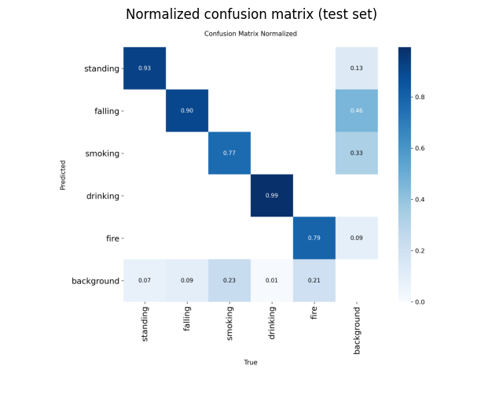
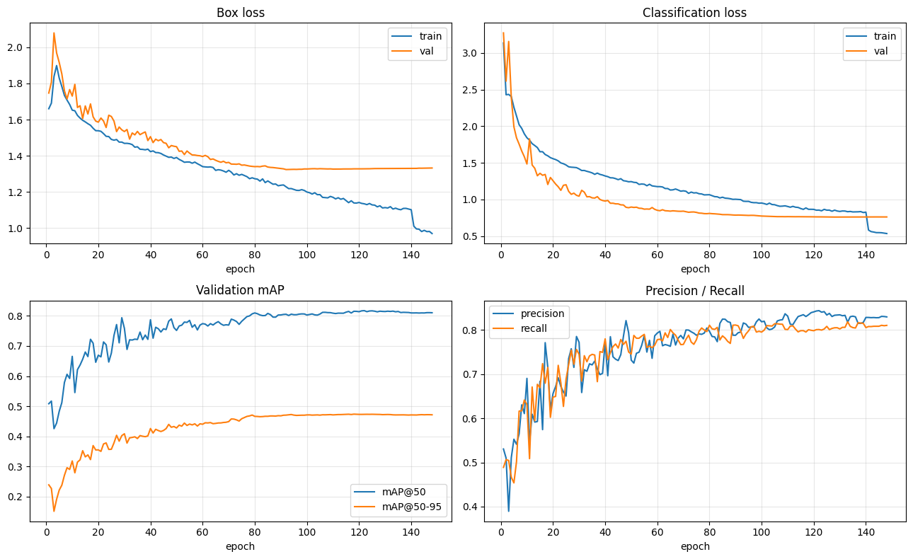
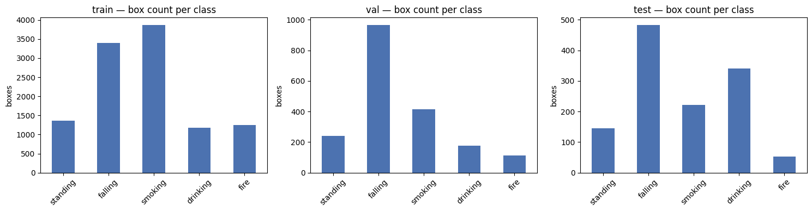

# 🎥 Wanees — Elderly Safety Action Detection

### *Real-time fall & fire detection on a Raspberry Pi 5 for an elderly-care robot*

> The computer-vision module of **Wanees (ونيس)**, an AI care robot for elderly people (graduation project).
> A YOLOv8n model watches the room through the robot's camera and raises an alert to the family's mobile app when the elderly person **falls** or when there is a **fire**.

[](https://www.python.org/)
[](https://docs.ultralytics.com/)
[](https://onnxruntime.ai/)
[](https://www.raspberrypi.com/)
[](#-results)

Companion repo — the voice assistant module: [Wanees Arabic Voice Assistant](https://github.com/assermosa/Wanees-Arabic-Voice-Assistant-For-Elder)

---

## 📋 Table of Contents

- [Why](#-why)
- [Classes](#-classes)
- [Results](#-results)
- [How It Works](#️-how-it-works)
- [Repository Structure](#-repository-structure)
- [Quick Start — Laptop Webcam](#-quick-start--laptop-webcam)
- [Deploy on Raspberry Pi 5](#-deploy-on-raspberry-pi-5)
- [Configuration](#️-configuration)
- [Training Pipeline](#-training-pipeline)
- [Roadmap](#️-roadmap)
- [License](#-license)

---

## 🌍 Why

Falls are one of the most serious risks for elderly people living alone, and help that arrives late makes the outcome far worse. Wanees keeps watch so the family doesn't have to: the robot detects dangerous situations on-device, in real time, and notifies relatives immediately.

## 🏷️ Classes

| ID | Class      | Purpose                          | Alert? |
|----|------------|----------------------------------|:------:|
| 0  | `standing` | Normal state (reference)         |   —    |
| 1  | `falling`  | Person falling / fallen          | 🚨 Yes |
| 2  | `smoking`  | Health-risk behaviour monitoring |   —    |
| 3  | `drinking` | Hydration / activity monitoring  |   —    |
| 4  | `fire`     | Fire hazard in the room          | 🚨 Yes |

## 📈 Results

Evaluated on the held-out **test split** (1,160 images, 1,244 objects), never seen during training or model selection:

| Class        | Precision | Recall | mAP@50    | mAP@50-95 |
|--------------|:---------:|:------:|:---------:|:---------:|
| standing     | 0.934     | 0.969  | 0.985     | 0.684     |
| **falling**  | 0.864     | 0.825  | **0.892** | 0.589     |
| smoking      | 0.819     | 0.631  | 0.728     | 0.368     |
| drinking     | 0.996     | 0.997  | 0.994     | 0.618     |
| **fire**     | 0.934     | 0.807  | **0.857** | 0.393     |
| **All**      | **0.909** | **0.846** | **0.891** | **0.531** |

- **Model size:** YOLOv8n, 3.0M parameters, 8.1 GFLOPs, 6 MB weights.
- **Speed on a Tesla T4 GPU:** 3.4 ms per image at 640×640.
- **Weakest class:** `smoking` has the lowest recall (0.63) because cigarettes are small objects. Collecting more close-up smoking data is the clearest next improvement.

<p align="center">
  
  
</p>

## ⚙️ How It Works

```
┌──────────────┐   freshest    ┌─────────────┐   640×640   ┌──────────────────┐
│ CameraThread │ ───frame────▶ │  letterbox  │ ──tensor──▶ │ ONNX Runtime     │
│ (PiCamera2 / │  (queue = 1)  │ (keeps the  │             │ YOLOv8n, 4 CPU   │
│  USB webcam) │               │  aspect     │             │ threads          │
└──────────────┘               │  ratio)     │             └────────┬─────────┘
                               └─────────────┘                      │ [1, 9, 8400]
                                                                    ▼
┌───────────────────────┐    ┌──────────────────┐     ┌──────────────────────────┐
│ Alert → family mobile │ ◀──│ falling / fire ? │ ◀── │ Vectorized NumPy decode  │
│ (3 s cooldown)        │    │ + HUD overlay    │     │ + NMS, boxes mapped back │
└───────────────────────┘    └──────────────────┘     └──────────────────────────┘
```

Design choices for real-time performance on the Pi's CPU:

- **ONNX Runtime only.** No PyTorch on the Pi, which means a smaller RAM footprint and faster boot.
- **Threaded capture with a queue of size 1.** The detector always processes the newest frame, so latency never builds up.
- **Letterbox preprocessing.** Frames are resized the same way Ultralytics does during training, so the geometry of a fallen person isn't distorted.
- **Fully vectorized decoding.** Decoding uses NumPy with OpenCV NMS instead of a Python loop over 8,400 anchors.
- **Frame skipping.** `--skip N` runs inference every Nth frame while the display stays smooth.
- **Auto-configuration.** The input size and class names are read from the ONNX model's own metadata.
- **Rate-limited alerts.** A 3-second cooldown stops a single fall from producing a flood of notifications.

## 📁 Repository Structure

```
Wanees-Safety-Action-Detection/
├── models/
│   ├── best.pt              ← trained YOLOv8n weights (PyTorch / Ultralytics)
│   └── best.onnx            ← ONNX export, 640×640 input, opset 12 (used on the Pi)
├── notebooks/
│   └── training.ipynb       ← full Kaggle training notebook: data merging → training → evaluation → export
├── docs/                    ← result charts used in this README
├── src/
│   ├── detect_webcam.py     ← quick test on a laptop webcam with Ultralytics
│   └── detector_pi5.py      ← optimized real-time detector for Raspberry Pi 5
├── data/
│   └── data.yaml            ← dataset config used for training (5 classes)
├── requirements.txt         ← laptop / training environment
├── requirements-pi.txt      ← Raspberry Pi runtime
└── README.md
```

## 💻 Quick Start — Laptop Webcam

```bash
git clone https://github.com/assermosa/Wanees-Safety-Action-Detection.git
cd Wanees-Safety-Action-Detection
pip install -r requirements.txt

python src/detect_webcam.py                 # uses models/best.pt, conf 0.7
python src/detect_webcam.py --conf 0.5      # more sensitive
```

Press **Q** to quit.

## 📟 Deploy on Raspberry Pi 5

**Hardware:** Raspberry Pi 5 with a Pi Camera Module (CSI) or a USB webcam.

```bash
# 1. System packages (PiCamera2 + OpenCV)
sudo apt update
sudo apt install -y python3-picamera2 python3-opencv

# 2. Python runtime
pip install -r requirements-pi.txt

# 3. Run
python3 src/detector_pi5.py               # with display
python3 src/detector_pi5.py --headless    # over SSH / no monitor
sudo python3 src/detector_pi5.py          # higher scheduling priority
```

If `picamera2` isn't available, the detector falls back to `cv2.VideoCapture` automatically.

**Faster inference:** the included ONNX model uses a 640×640 input. For a lighter 320×320 version (about 4× fewer pixels to process), export it from the PyTorch weights:

```bash
yolo export model=models/best.pt format=onnx imgsz=320 opset=12 simplify=True
python3 src/detector_pi5.py --model models/best_320.onnx
```

The input size is detected automatically from the model.

## 🎛️ Configuration

| Flag          | Default            | Description                                    |
|---------------|--------------------|------------------------------------------------|
| `--model`     | `models/best.onnx` | Path to the ONNX model                         |
| `--conf`      | `0.35`             | Confidence threshold                           |
| `--iou`       | `0.45`             | NMS IoU threshold                              |
| `--skip`      | `2`                | Run inference every Nth frame                  |
| `--size`      | auto               | Override inference size                        |
| `--threads`   | `4`                | ONNX Runtime threads (Pi 5 has 4 cores)        |
| `--camera`    | `0`                | USB camera index (ignored with PiCamera2)      |
| `--classes`   | from model         | Comma-separated class names, in training order |
| `--headless`  | off                | Disable the display window                     |

## 🧪 Training Pipeline

The full pipeline is in [`notebooks/training.ipynb`](notebooks/training.ipynb). It ran on Kaggle with a Tesla T4 GPU.

### 1. Data: merging five public datasets

No single public dataset covers all five classes, so the notebook downloads five Roboflow Universe datasets and maps each one's labels onto the unified classes. Classes outside those five (for example `sitting`, `walking`, `Vape`) are dropped, and images left with no labels are skipped.

| Source dataset (Roboflow) | Provides | Label mapping |
|---|---|---|
| `human-action-recognition-x6cml` | standing, falling | `Fall-Detected`, `falling` → **falling** |
| `employee-productivity-2.0-whbwv` | smoking | `Cigarette`, `Smoke` → **smoking** |
| `smoking-and-drinking-detection` | smoking | `smoking` → **smoking** |
| `fire-dataset-for-yolov8` | fire | `fire` → **fire** |
| `drinking-1700` | drinking | `Drinking` → **drinking** |

**Result:** 12,476 images in total: **9,508 train**, **1,808 validation**, **1,160 test**.

<p align="center"></p>

### 2. Data cleaning and split balancing

- **Unique file names:** each image is prefixed with its source dataset name, so files from different sources can't collide.
- **Validation coverage:** the drinking dataset had no validation split. The notebook moved 15% of its training images (178) into validation so every class is measured during training.
- **Test-split balance:** drinking had 30% of its images in the test split. The notebook moved 170 of them back to training to bring its share in line with the other classes.
- **Imbalance check:** a capping step limits any class that dominates the training data. No class exceeded the cap, so nothing was removed.
- **Visual checks:** class-distribution charts and sample images with their boxes drawn were reviewed before training.

### 3. Training

| Setting | Value | Why |
|---|---|---|
| Base model | `yolov8n.pt` (COCO-pretrained) | Smallest YOLOv8 model, suited to edge deployment |
| Image size | 640 | Full-resolution training; a smaller size can be exported later |
| Epochs | 150 with `patience=30` | Early stopping once validation mAP plateaus |
| LR schedule | Cosine (`cos_lr=True`) | Smoother convergence |
| `close_mosaic` | Last 10 epochs | Stabilizes bounding-box regression |
| Augmentation | mixup 0.1, rotation ±5°, translate 0.1, scale 0.5, horizontal flip | Generalization without distorting rare classes |
| Seed | 42 | Reproducible runs |

### 4. Evaluation and export

- **Evaluation:** validation curves, test-set metrics (table above) and a normalized confusion matrix.
- **Export:** ONNX, opset 12, simplified, without NMS in the graph (NMS runs in the detector).
- **Packaging:** the weights, models and charts are zipped for download from Kaggle.

> **Note:** in the original run, the 320 and 640 exports overwrote each other, so both `best_320.onnx` and `best_640.onnx` contained the 640 model. The notebook's export cell now saves each size under its own name.

> The dataset images aren't included in this repo because of their size. Running the notebook with a Roboflow API key rebuilds the dataset.

## 🗺️ Roadmap

- [x] Five-class YOLOv8n safety detector
- [x] Real-time ONNX deployment on Raspberry Pi 5
- [x] Rate-limited fall and fire alerts
- [x] Publish the training notebook and evaluation metrics
- [ ] Improve `smoking` recall with more close-up cigarette data
- [ ] Add more indoor fall footage of elderly people in home settings
- [ ] INT8 quantization for higher FPS on the Pi
- [ ] Temporal smoothing (require N consecutive "falling" frames) to reduce false alarms
- [ ] Combine with the Wanees voice assistant: ask "Are you okay?" before alerting the family

## 📄 License

The trained model was produced with [Ultralytics YOLOv8](https://github.com/ultralytics/ultralytics), which is licensed under **AGPL-3.0**, so the model files and the code in this repository are released under AGPL-3.0 as well.

---

**Built with care for the people who built our world.** 🤍
